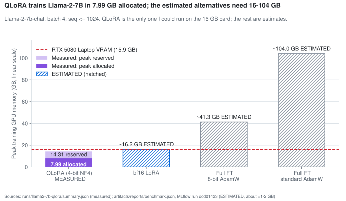
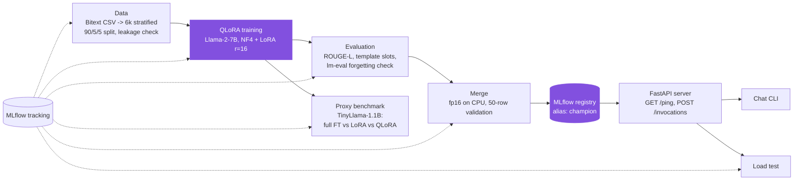
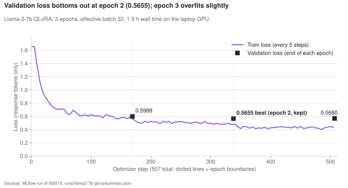
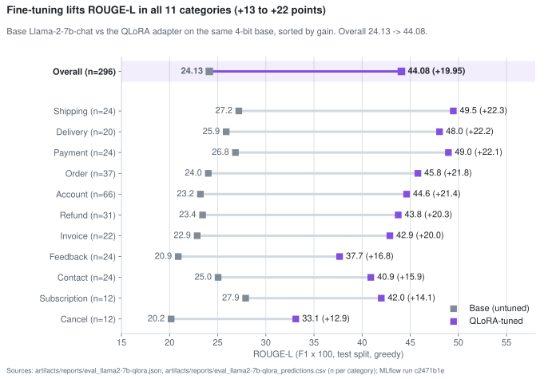
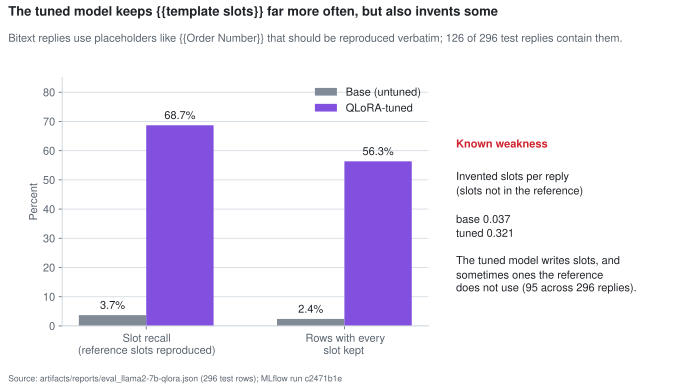
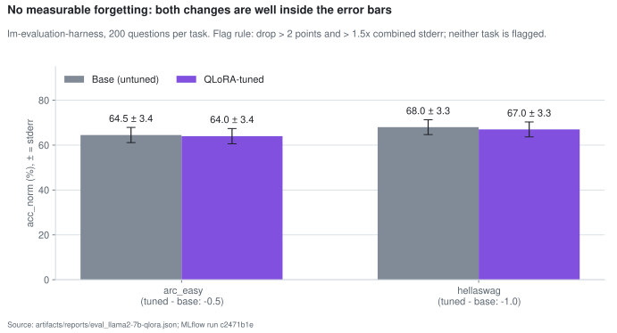
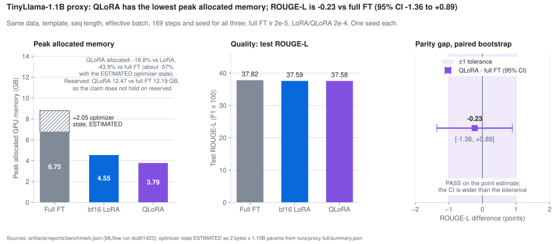
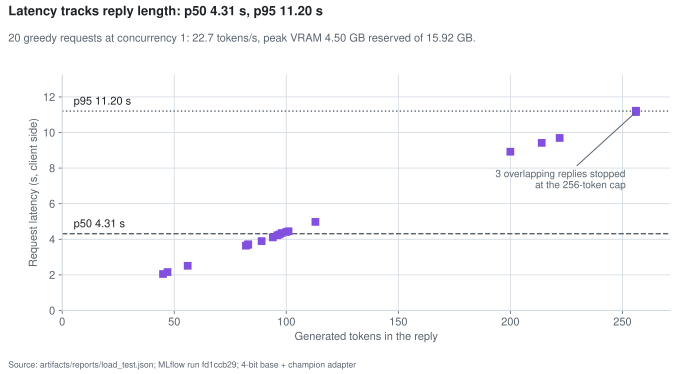

# QLoRA fine-tuning of Llama-2-7B on a 16 GB laptop GPU

I fine-tuned `Llama-2-7b-chat` into an e-commerce customer-support assistant with QLoRA on one laptop GPU, measured what it actually cost and gained, and served it behind a SageMaker-compatible API.


<picture>
  <source media="(prefers-color-scheme: dark)" srcset="docs/images/01-hero-7b-memory-dark.svg">
  
</picture>

| Headline | Result |
|---|---|
| **Quality** | ROUGE-L **24.13 -> 44.08** on 296 held-out support messages (base vs tuned, same 4-bit base) |
| **Memory** | 7B fine-tune peaked at **7.99 GB allocated** (14.31 GB reserved) on a 16 GB laptop GPU |
| **Parity** | QLoRA vs full fine-tuning on a 1.1B proxy: **-0.23 ROUGE-L** (95% CI -1.36 to +0.89) |
| **Forgetting** | None measurable on `arc_easy` and `hellaswag` (-0.5 and -1.0 points, inside the error bars) |

---

## Why I built this

QLoRA's pitch is that you can fine-tune a 7B model on consumer hardware without giving up quality. I wanted to do that end to end on my own laptop and **measure** each part of the claim: how much memory it really takes, whether the tuned model is actually better, whether it forgets general knowledge, and whether 4-bit training loses quality against full fine-tuning. Everything here is a number I measured or an estimate I labelled as one.

---

## What I built



- **Data:** I download the Bitext customer-support set, validate and clean it, subsample 6,000 rows stratified by intent, split it, check for leakage, and write a data card.
- **Training:** QLoRA on `Llama-2-7b-chat` with `TRL`'s `SFTTrainer`, loss on response tokens only, checkpoints every 50 steps with auto-resume, and the best epoch kept.
- **Evaluation:** the base and tuned model share one 4-bit load (the base pass just disables the adapter), so the comparison isolates the adapter.
- **Proxy benchmark:** a 7B full fine-tune does not fit on 16 GB, so I ran full FT, bf16 LoRA and QLoRA on `TinyLlama-1.1B`, which has the Llama 2 architecture and tokenizer, with identical settings.
- **Merge and registry:** the adapter is merged into the fp16 base on CPU, validated against the adapter model, and registered in `MLflow` under the alias `champion`.
- **Serving:** `FastAPI` + `uvicorn` speaking SageMaker's inference contract, with a chat REPL and a load test as clients.

Every stage logs to one local `MLflow` experiment, and every stage is one command (`qlora <stage>`).

---

## My setup and constraints

| | |
|---|---|
| GPU | RTX 5080 Laptop, 16 GB, Blackwell `sm_120` |
| CPU / RAM | Intel Core Ultra 7 255HX, 32 GB |
| OS | Windows 11, native (no WSL) |
| Storage rule | everything on `G:\QLoRA`; a C: audit after every phase |
| Python | 3.11.15, managed by `uv` |
| Key libraries (from `uv.lock`) | `torch` 2.11.0+cu128, `transformers` 5.23.0, `peft` 0.22.0, `trl` 1.18.1, `bitsandbytes` 0.50.2, `accelerate` 1.16.0, `datasets` 5.2.0, `mlflow` 3.18.0, `fastapi` 0.165.0 |

I set myself one hard rule: **nothing lands on C:**. Every cache, download, venv, checkpoint and MLflow record lives under `G:\QLoRA`, set per session by `qlora.env`, and `qlora audit-c` compares seven default cache locations on C: against a baseline taken before anything was installed. It fails the phase if any of them grows by more than 50 MB.

---

## Data

Source: [`bitext/Bitext-customer-support-llm-chatbot-training-dataset`](https://huggingface.co/datasets/bitext/Bitext-customer-support-llm-chatbot-training-dataset), pinned to one commit. Full details are in the [data card](docs/reports/data_card.md).

| Step | Rows |
|---|---:|
| Raw | 26,872 |
| After validation (10 replies with malformed or nested `{{slots}}` dropped) | 26,862 |
| After dedupe (2,796 near-duplicate customer messages) | 24,066 |
| Stratified subsample by intent, seed 42 | 6,000 |
| Train / val / test (90/5/5, stratified by intent) | 5,408 / 296 / 296 |

- **Leakage check:** zero overlap between train and val/test on normalized customer messages, and none between val and test.
- **Token lengths:** p50 161, p99 480, max 620 tokens, so a 1,024-token limit truncates nothing.
- **Template slots:** 2,594 of the 6,000 replies contain placeholders like `{{Order Number}}`. I keep them verbatim, because they are part of the house style the model should learn.

---

## Training

| Setting | Value |
|---|---|
| Base model | `meta-llama/Llama-2-7b-chat-hf` (pinned revision) |
| Quantization | 4-bit **NF4**, double quantization, `bfloat16` compute |
| LoRA | r = 16, alpha = 32, dropout 0.05, on all linear layers (`q,k,v,o,gate,up,down`) |
| Trainable parameters | 39.98M of 6.78B (0.59%) |
| Optimizer | paged AdamW 8-bit, lr 2e-4, cosine schedule, warmup 3%, grad-norm clip 0.3 |
| Batch | 4 per step x 8 accumulation = effective batch 32 |
| Sequence length | 1,024 tokens |
| Epochs | 3 (507 optimizer steps), eval every epoch, best checkpoint kept |

- **Response-only loss:** the system prompt and the customer message are masked to -100, so the model only learns the agent's reply, and I keep EOS in the labels so it learns to stop.
- **Pad token:** Llama 2 has no pad token. I add a dedicated `<pad>` (never EOS), resize the embeddings to a multiple of 64, and **zero-initialise** the new rows. Because the rows are deterministic, the adapter does not need to carry the embeddings, and every reload rebuilds the exact same model.

<picture>
  <source media="(prefers-color-scheme: dark)" srcset="docs/images/06-training-curves-dark.svg">
  
</picture>

Training took **1.9 hours**. Validation loss was best after epoch 2 (0.5655, perplexity 1.76), so that is the adapter I kept.

---

## Results

### Quality

<picture>
  <source media="(prefers-color-scheme: dark)" srcset="docs/images/02-quality-by-category-dark.svg">
  
</picture>

| Metric (296 test messages, greedy) | Base | Tuned |
|---|---:|---:|
| ROUGE-L | 24.13 | **44.08** |
| Validation perplexity (response tokens) | 5.003 | **1.733** |
| Template-slot recall | 3.7% | **68.7%** |
| Replies with every slot kept | 2.4% | **56.3%** |
| Invented slots per reply | 0.037 | 0.321 |

<picture>
  <source media="(prefers-color-scheme: dark)" srcset="docs/images/03-template-slots-dark.svg">
  
</picture>

The tuned model learned the house style, placeholders included. The weakness is that it now writes slots the reference reply does not use: 95 across 296 replies.

### Forgetting

<picture>
  <source media="(prefers-color-scheme: dark)" srcset="docs/images/04-no-forgetting-dark.svg">
  
</picture>

I ran `lm-evaluation-harness` on 200 questions per task. My rule flags forgetting only if a drop is larger than 2 points **and** larger than 1.5x the combined standard error. Neither task is flagged; both changes are well inside the noise.

### Memory: measured vs estimated

<picture>
  <source media="(prefers-color-scheme: dark)" srcset="docs/images/05-proxy-benchmark-dark.svg">
  
</picture>

| TinyLlama-1.1B proxy, 169 steps each | Full FT | bf16 LoRA | QLoRA |
|---|---:|---:|---:|
| Peak allocated (GB) | 6.75 (+~2.05 ESTIMATED optimizer state) | 4.55 | **3.79** |
| Peak reserved (GB) | 12.19 | 13.30 | 12.47 |
| Tokens/s | 1,733 | 2,240 | 1,839 |
| Test ROUGE-L | 37.82 | 37.59 | 37.58 |

**How to read this.** The 7B QLoRA run is the only 7B number I measured. bf16 LoRA (~16.2 GB) and full fine-tuning (~41.3 GB with 8-bit AdamW, ~104 GB with standard AdamW) do not fit on a 16 GB card, so I **estimated** them from the parameter count plus the activation memory I measured in the QLoRA run, and I drew them hatched. I checked that formula on the proxy, where bf16 LoRA was measured: it predicted 4.74 GB against 4.55 GB measured (+4%), so I treat the 7B estimates as roughly ±1-2 GB. On the proxy, QLoRA needs **16.8% less** allocated memory than bf16 LoRA and **43.9% less** than full FT (about 57% less once full FT's optimizer state is counted). On reserved memory the claim **does not** hold: QLoRA reserved 12.47 GB against full FT's 12.19 GB. The full numbers are in the [benchmark report](docs/reports/benchmark.md).

---

## Serving

I serve the 4-bit base plus the `champion` adapter, resolved from the MLflow registry and verified against its registered SHA-256. If that load fails, the server falls back to the merged model in 4-bit.

| Route | Behaviour |
|---|---|
| `GET /ping` | 503 while the model loads, 200 once it is ready |
| `POST /invocations` | `{"inputs": "...", "parameters": {"max_new_tokens": .., "temperature": ..}}` -> `{"generated_text": "..."}` |

```bash
curl -s -X POST http://127.0.0.1:8080/invocations -H "Content-Type: application/json" -d '{"inputs": "I want to cancel my order, how do I do that?", "parameters": {"max_new_tokens": 200, "temperature": 0.0}}'
```

**Why SageMaker's routes:** I ran everything locally, but I matched SageMaker's container contract (`/ping`, `/invocations`, port 8080) so the same server and `Dockerfile` can move to a managed endpoint later without code changes.

<picture>
  <source media="(prefers-color-scheme: dark)" srcset="docs/images/07-serving-latency-dark.svg">
  
</picture>

| Load test (20 greedy requests, concurrency 1) | Value |
|---|---:|
| Successful | 20 / 20 |
| Latency p50 / p95 | 4.31 s / 11.20 s |
| Throughput | 22.7 tokens/s |
| Peak VRAM | 4.50 GB reserved of 15.92 GB |

Latency is driven by reply length: the slow tail is the replies that run up to the 256-token cap.

---

## What broke and how I fixed it

**Getting Blackwell (`sm_120`) to work on native Windows**
- **Symptom:** Blackwell needs CUDA 12.8+ kernels, and `bitsandbytes` has a history of Windows wheels without them.
- **Cause:** older `torch` and `bitsandbytes` wheels don't ship `sm_120` kernels.
- **Fix:** I pinned `torch` 2.11.0 from the cu128 index and `bitsandbytes` 0.50.2, and made `qlora env-check` prove it with a real 4-bit forward and backward pass on a tiny Llama, not just an import.
- **Evidence:** `sm_120` is in the torch arch list, the `bitsandbytes` self-test passes, and the 4-bit step produces LoRA gradients and a falling loss.

**Keeping C: clean**
- **Symptom:** after the Python install, files and settings appeared outside G:.
- **Cause:** `uv` dropped a `python3.11.exe` shim into `%USERPROFILE%\.local\bin` and registered the interpreter under `HKCU\Software\Python\Astral`.
- **Fix:** I moved the shim, removed the registry key, and added `UV_PYTHON_BIN_DIR` and `UV_PYTHON_INSTALL_REGISTRY=0` to `qlora.env` so it cannot recur. The C: audit runs after every phase.
- **Evidence:** the final audit shows every watched location within +1.0 MB of the baseline.

**The pagefile mystery**
- **Symptom:** C: free space fell from 22.21 GB to 13.67 GB while all seven watched folders stayed at +0.0 MB.
- **Cause:** on Windows (WDDM), every byte of VRAM that PyTorch reserves is charged 1:1 to system commit. I measured +8.0 GB of VRAM as +8.0 GB of commit. With other apps already holding about 43 GB, a 7B job pushed commit past its limit, and Windows grew the system-managed `C:\pagefile.sys`. My audit logs recorded it at up to 22,096 MB against a 9,031 MB reference.
- **Fix:** G: is BitLocker-encrypted, so it cannot host a pagefile. I capped the C: pagefile at 4-16 GB and added a pre-flight guard for large-model jobs. The guard refuses to start if commit headroom (RAM + pagefile cap - commit in use) is below the job's **measured** peak + 3 GB, or if C: cannot absorb the pagefile growing to its cap + 10 GB, and it lists the top processes by commit. The audit gained a pagefile row.
- **Evidence:** `logs/c_audit_*.json`, the guard's measured per-job peaks in [`commit_peaks.json`](docs/reports/commit_peaks.json), and a final audit with the pagefile back at 4,096 MB.

**The silent GPU memory spill**
- **Symptom:** the full 7B evaluation brought system commit to 47.25 GB against a 47.37 GB limit.
- **Cause:** PyTorch had reserved **26.01 GB on a 16 GB card**. NVIDIA's CUDA Sysmem Fallback Policy was silently spilling the overflow into system RAM. A per-stage probe found the culprit in **generation**: 16.79 GB reserved for 6.05 GB allocated, because the growing KV cache fragmented the allocator. Turning the fallback off globally didn't take at first, because the venv's `python.exe` is only a launcher and the process that actually runs is the base interpreter, which needed its own NVIDIA program profile.
- **Fix:** generation batch 16 -> 8, releasing the cache between batches, and a hard 14 GB reserved-VRAM cap in PyTorch. Every benchmark run then started with a check that allocating physical VRAM + 1 GB raises out-of-memory.
- **Evidence:** every eval stage now peaks at or below 7.06 GB reserved, and eval process commit fell from 30.16 GB to 15.48 GB. That first probe still ran with the fallback on; the 14 GB PyTorch cap, not the driver setting, is what bounded it.
- **Results:** spilling slows a run down but does not change its numbers, so the original evaluation results stand.

**Benchmark honesty**
- **Paged optimizer state:** paged 8-bit AdamW keeps its state in CUDA managed memory, which `torch.cuda.max_memory_allocated` never sees. Full FT's measured 6.75 GB therefore misses about 2.05 GB, which I add back as a hatched ESTIMATED segment instead of mixing it into the measurement.
- **Two memory metrics:** peak *reserved* memory includes PyTorch's cache and depends on allocation patterns, so it can contradict *allocated*, and on the proxy it does. I report both and state which claim held on which.
- **Parity uncertainty:** QLoRA's 0.23-point gap to full FT is a single seed on 296 examples. The 95% CI (-1.36 to +0.89) is wider than my ±1.0 tolerance, so I call it a pass on the point estimate, not proof of equality.

---

## Limitations

- The 7B run peaked at **14.31 GB reserved**, just over my 14 GB target (allocated was 7.99 GB). I accepted it rather than retrain.
- Full FT's optimizer state on the proxy (~2.05 GB) is **estimated**, not measured.
- The parity CI [-1.36, +0.89] is **wider** than the ±1.0 tolerance. That is one seed per method, and full FT used lr 2e-5 against 2e-4 for LoRA and QLoRA.
- I validated the merged model **in 4-bit** (merged 44.39 vs adapter 43.99 ROUGE-L on 50 rows, +0.40 against a ±0.5 tolerance). The fp16 merge does not fit the 14 GB cap with a KV cache, and only 12% of the 50 replies were word-for-word identical.
- The 7B training run **started from uncommitted code**. It is tagged in MLflow with the commit and a note on what changed after launch.
- Proxy tokens/s is **confounded by throttling**: the GPU was power-limited for 76% of the full-FT run and about 100% of the other two.
- ROUGE-L on templated Bitext replies is best read comparatively: absolute scores are high for any model that learns the house style.
- The chat endpoint is single-turn, because the model was trained on single-turn data.

---

## Reproduce it

**Prerequisites:** Windows 11, an NVIDIA GPU with a CUDA 12.8+ driver, about 60 GB free on the data drive, a Hugging Face token with Llama 2 access, and the standalone `uv.exe`.

1. Put `qlora.env`, `env.ps1` and `env.sh` in `G:\QLoRA`. `qlora.env` is the only file that names the drive letter.
2. Put `uv.exe` in `G:\QLoRA\tools\uv`. Use the release zip, not the installer script, which writes to C:.
3. Run the bootstrap. It takes the C: baseline first, then installs Python 3.11 and the locked stack into `repo\.venv`:
   ```powershell
   powershell -ExecutionPolicy Bypass -File G:\QLoRA\repo\scripts\bootstrap.ps1
   ```
4. Copy `repo\.env.example` to `repo\.env` and set `HF_TOKEN`. That file is gitignored.
5. Two Windows settings this build needed:
   - **NVIDIA:** in NVIDIA Control Panel, set **CUDA - Sysmem Fallback Policy = Prefer No Sysmem Fallback** globally **and** for `G:\QLoRA\tools\python\cpython-3.11.15-windows-x86_64-none\python.exe`.
   - **Pagefile:** give C: a **fixed** pagefile size.
6. Start `MLflow` in its own shell (`.\run.ps1 mlflow`), then run each stage:

| Stage | Command | My run time |
|---|---|---:|
| Environment check | `.\run.ps1 env-check` | seconds |
| Data | `.\run.ps1 data` | 16 s |
| Smoke test (proxy, 50 steps) | `.\run.ps1 smoke` | 2.6 min |
| Train 7B QLoRA | `.\run.ps1 train -c llama2_7b_qlora.yaml` | 1.9 h |
| Evaluate base vs tuned | `.\run.ps1 eval -c llama2_7b_qlora.yaml` | 18 min |
| Proxy benchmark | `.\run.ps1 bench` | 40 min |
| Merge + validate + register | `.\run.ps1 merge` | 0.8 min merge + 7.2 min validation |
| Serve | `.\run.ps1 serve` | TODO-source (startup time was not logged) |
| Chat | `.\run.ps1 chat` | interactive |
| Load test | `.\run.ps1 load-test` | 1.9 min |
| Figures | `.\run.ps1 figures` | seconds |
| C: audit | `.\run.ps1 audit-c` | seconds |

The run times come from [`stage_timings.json`](docs/reports/stage_timings.json). The 18-minute eval ran before the generation batch fix, with the fallback still spilling. `run.ps1` activates the environment and calls the `qlora` CLI; any config value can be overridden with `--set key=value`.

---

## Project structure

```
repo/
  configs/      base.yaml, llama2_7b_qlora.yaml, proxy_{full,lora,qlora}.yaml, serve.yaml, serve_container.yaml
  src/qlora_pipeline/
                cli, config, paths, data, model, train, evaluate, benchmark, merge, serve, telemetry, audit
  scripts/      bootstrap.ps1, make_figures.py, figure_theme.py, chat_cli.py, load_test.py,
                commit_diag.py, watch_system.ps1, container_entrypoint.sh
  tests/        data, label masking, prompt format, config, paths, pre-flight, eval metrics, serve API
  docs/images/  figures (light + dark SVG, 2x PNG); docs/reports/ report snapshots
  Dockerfile    written, not built (Docker Desktop keeps its disk image on C:)
G:\QLoRA\       qlora.env, tools\, cache\, data\, runs\, artifacts\, mlflow\, logs\  (outside the repo)
```

---

## What I'd do next

- **More seeds for parity:** run 3-5 seeds per method so the parity CI can actually fall inside the tolerance.
- **Measure the full-FT optimizer state:** use non-paged 8-bit AdamW so PyTorch's counters see it, instead of estimating it.
- **Build the Docker image off C:**, on a machine or Docker setup whose disk image does not land on the system drive.
- **Add a Linux lockfile:** `uv.lock` is Windows-only today, so the container installs unpinned.
- **Try a newer base model:** Llama 3.x, which is a one-line change of `model.name` in the config.

---

## How I built it

I designed and directed this project and used Claude Code as an AI pair-programmer for implementation and review.

---

## Licenses and credits

- **Llama 2** weights are under the [Llama 2 Community License](https://ai.meta.com/llama/license/). The weights are not included in this repo.
- **Bitext customer-support dataset:** CDLA-Sharing-1.0, per its dataset card.
- **TinyLlama-1.1B** ([TinyLlama/TinyLlama-1.1B-intermediate-step-1431k-3T](https://huggingface.co/TinyLlama/TinyLlama-1.1B-intermediate-step-1431k-3T)) is the proxy model.
- **QLoRA:** Dettmers et al., 2023, [*QLoRA: Efficient Finetuning of Quantized LLMs*](https://arxiv.org/abs/2305.14314).

---

## Author

[](https://dheerajpiduru.online)
[](https://www.linkedin.com/in/dheerajpiduru/)
[](mailto:dheerajpiduru.9@gmail.com)
